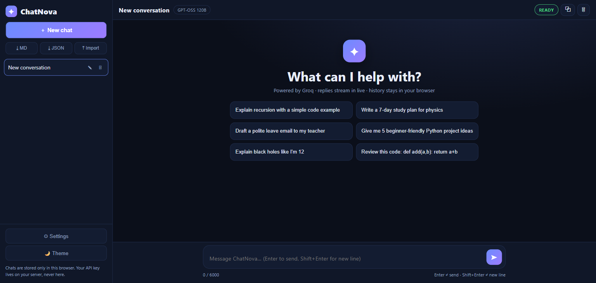
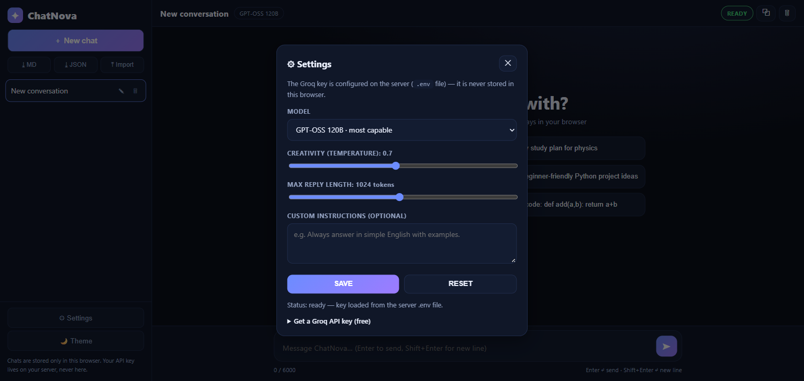
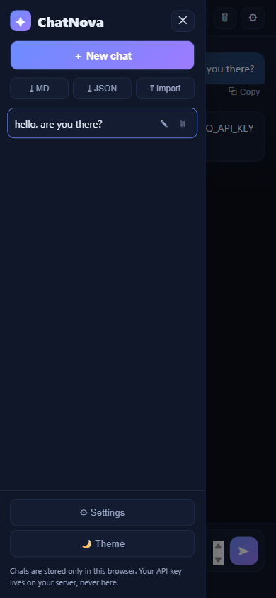

# AIChatbot — ChatNova

A polished, single-user AI chat app: multi-conversation sidebar, live
streaming replies, Markdown + code highlighting, model picker, dark/light
themes, and Markdown/JSON export — powered by [Groq](https://groq.com/).

This is a **starter project you run on your own computer**. The backend
(this repo's Python part) talks to Groq; the static frontend
(`static/index.html` + `styles.css` + `app.js` + `chatlib.js`) plays
against the API below.

## Features

- New / switch / rename / delete conversations (with delete confirmation)
- Conversation history in a sidebar — survives page refreshes (browser localStorage)
- Real Groq-powered replies with **live streaming** output + Stop button
- Markdown rendering: headings, lists, tables, blockquotes, links
- Fenced code blocks with language label + copy button; copy any message
- Regenerate last reply; retry button after failures
- Model selector (server-validated allowlist): GPT-OSS 120B / GPT-OSS 20B
- Configurable creativity (temperature), max reply length, custom instructions
- Dark + light themes, responsive mobile drawer layout
- Welcome screen with suggested prompts; multiline composer (Enter sends, Shift+Enter newline)
- Character counter, auto-growing input, scroll-to-latest
- Export any conversation as Markdown or JSON; import validated chat files
- Clear conversation; copy full conversation
- Friendly setup banner + in-app key guide when no API key is configured

## Tech

- [FastAPI](https://fastapi.tiangolo.com/) — web API, serves `static/` on port 8005
- [Groq](https://groq.com/) via the OpenAI-compatible client (`https://api.groq.com/openai/v1`),
  default model `openai/gpt-oss-120b` (override with `GROQ_MODEL`, allowlisted)
- Server-sent events (`POST /api/chat/stream`) for token streaming
- `python-dotenv` loads `.env`; the API key lives in server memory/env only
- No database, no accounts, no paid dependencies

## Screenshots

| Welcome (dark) | Settings | Mobile |
| --- | --- | --- |
|  |  |  |

## Requirements

- Python 3.10+
- A Groq API key (free at https://console.groq.com/keys — looks like `gsk_...`)
- pip packages: `pip install -r requirements.txt`

## Setup

```powershell
cd "C:\Users\rayan\Downloads\ai projects\AIChatbot"
python -m venv .venv
.\.venv\Scripts\Activate.ps1
pip install -r requirements.txt
copy .env.example .env
# edit .env and paste your GROQ_API_KEY
```

Or without a virtualenv:

```powershell
pip install -r requirements.txt
```

## Groq key

Server-side only (this project has no in-browser key entry on purpose):

1. Get a free key at https://console.groq.com/keys.
2. Set `GROQ_API_KEY=gsk_...` in `.env` (never commit `.env` — it is git-ignored).
3. Restart the app. `GET /api/status` shows `{"configured": true, "source": "env", ...}`.

Without a key, the app still opens and shows a setup banner explaining exactly what to do.

## Run

```powershell
python app.py
# or: uvicorn app:app --port 8005
```

Open http://127.0.0.1:8005/

Optional overrides in `.env`:

```ini
GROQ_MODEL=openai/gpt-oss-20b   # must be an allowlisted model, else default is used
PORT=8005
```

## API

| Method | Endpoint | What it does |
| --- | --- | --- |
| `GET` | `/` | Frontend |
| `GET` | `/api/status` | `{ok, configured, source, model, models, message}` — never includes the key |
| `GET` | `/api/models` | `{ok, default, models}` allowlist |
| `POST` | `/api/chat` | `{messages, model?, temperature?, max_tokens?, system?}` → `{ok, reply, model}` |
| `POST` | `/api/chat/stream` | Same body; SSE `data: {"delta"}` tokens, `event: done` with full reply, `event: error` on failure |

Request bounds (enforced server-side): 1–40 messages per call, each ≤ 6000
chars, history ≤ 24000 chars total, temperature 0–1.5, max_tokens 64–2048,
custom instructions ≤ 1000 chars, model must be allowlisted. Chat endpoints
are rate-limited to 30 requests/minute per IP.

## Security notes

- The Groq key never leaves the server: it is read from the environment,
  never embedded in HTML/JS, never returned by any endpoint, never written
  to disk by the app. Tests assert responses contain no key material.
- Chat history is stored in the browser's localStorage — convenient for a
  single-user starter, but anyone with access to that browser profile can
  read it. The app shows a privacy note to that effect.
- Model output is rendered safely: the Markdown renderer escapes all HTML
  first, allows only `http(s)`/`mailto` links, and never executes scripts.
- Conversations are sent only to Groq (to generate the reply you asked
  for) — no analytics, no other third parties.
- Errors are mapped to friendly messages; tracebacks and provider internals
  are never exposed to the browser.

## Limitations

- Single user, single process: conversations live in your browser, server
  holds no state (restarting the server loses nothing).
- Attachments are intentionally unsupported: the text models used cannot
  inspect files, so the app does not pretend otherwise. Paste text instead.
- Streaming needs a modern browser (uses `fetch` + `ReadableStream`).
- Free-tier Groq rate limits apply to your key (see console.groq.com).

## Project structure

```text
AIChatbot/
  app.py                # FastAPI backend: status, chat, SSE stream, validation, limits
  requirements.txt      # runtime deps
  requirements-test.txt # pytest + httpx (tests only)
  .env.example          # placeholder config (copy to .env, add your key)
  static/
    index.html          # chat UI shell
    styles.css          # dark/light themes, responsive layout
    app.js              # UI logic: conversations, streaming, settings, export/import
    chatlib.js          # pure helpers: safe Markdown, export/import validation
    favicon.svg         # original ChatNova mark
  tests/
    conftest.py         # sys.path bootstrap
    test_chat.py        # 20 contract tests (mocked Groq)
    test_stream.py      # 7 SSE tests incl. disconnect
    test_frontend.mjs   # 12 node tests for chatlib (XSS, markdown, import/export)
  screenshots/          # genuine UI screenshots
```

## Tests

Mocked provider — no real API key or spending needed:

```powershell
python -m pytest tests/ -q
node tests/test_frontend.mjs
```

Expected: **29 passed** (pytest) + **12 passed** (node). A live Groq smoke
test is intentionally not part of the suite; if you have a key configured
you can verify manually by sending one message and watching tokens stream.
